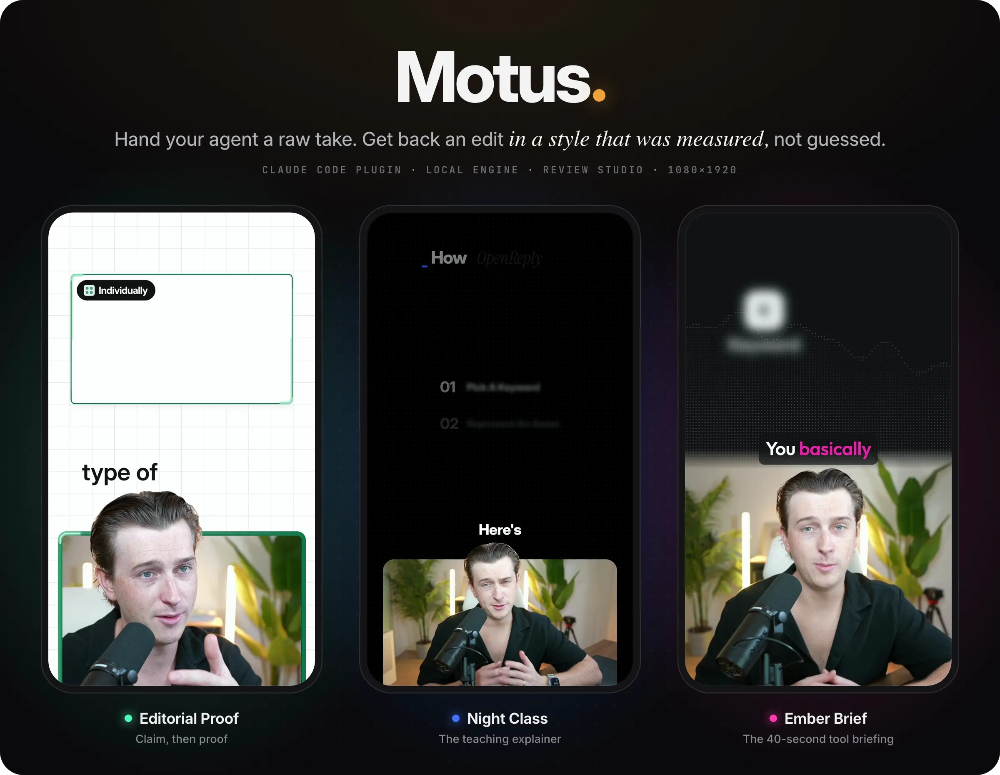
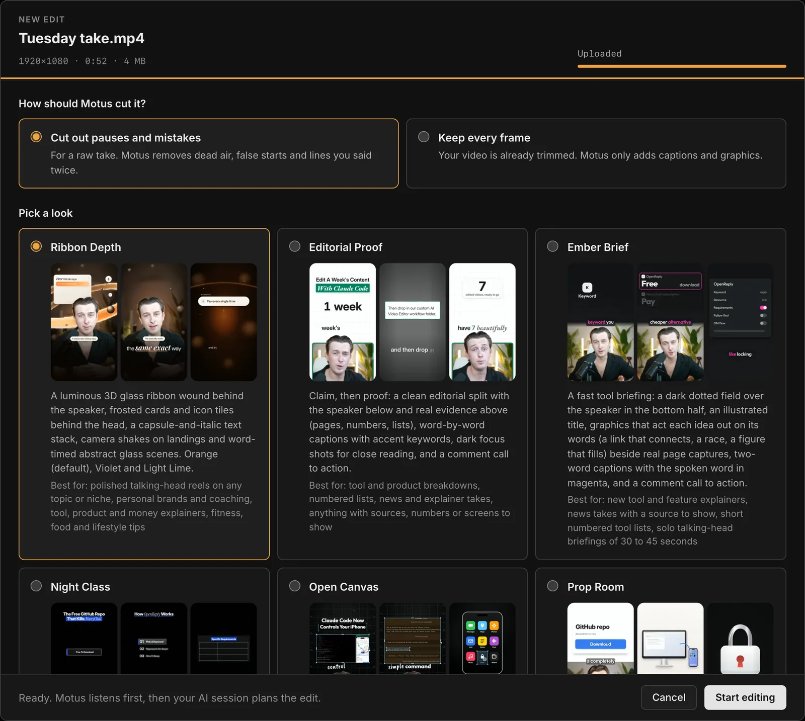
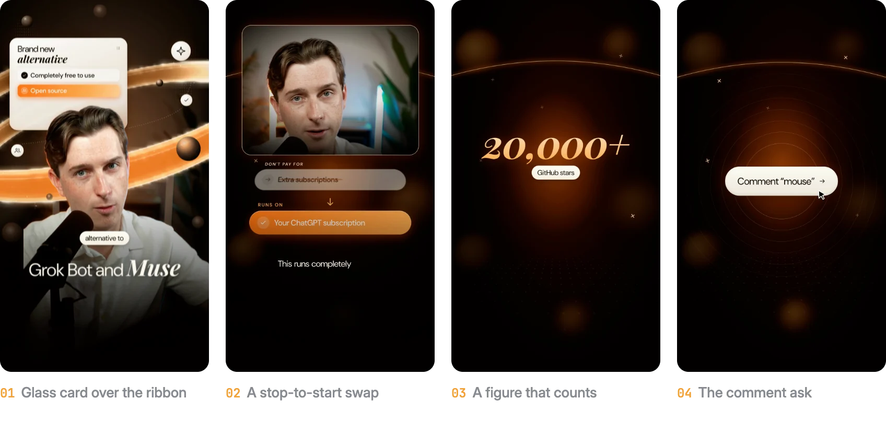
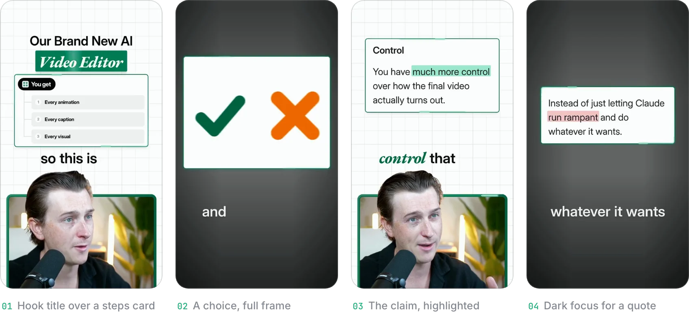
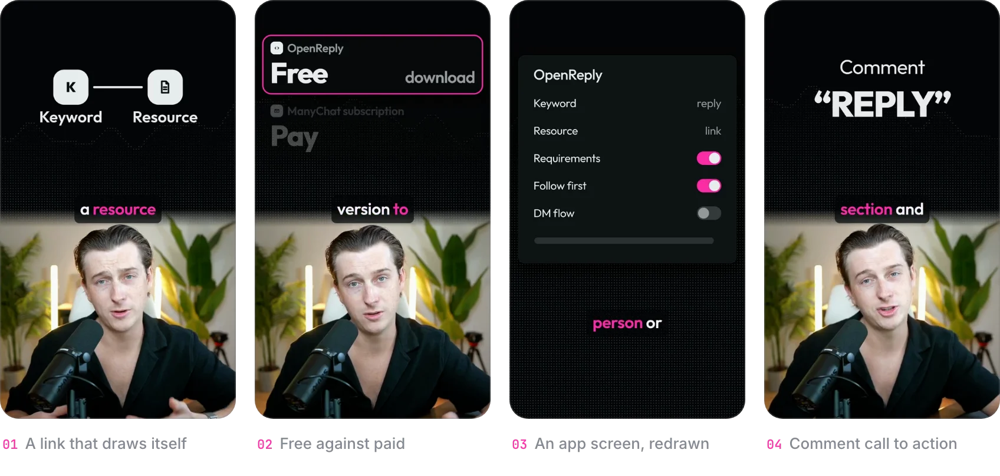
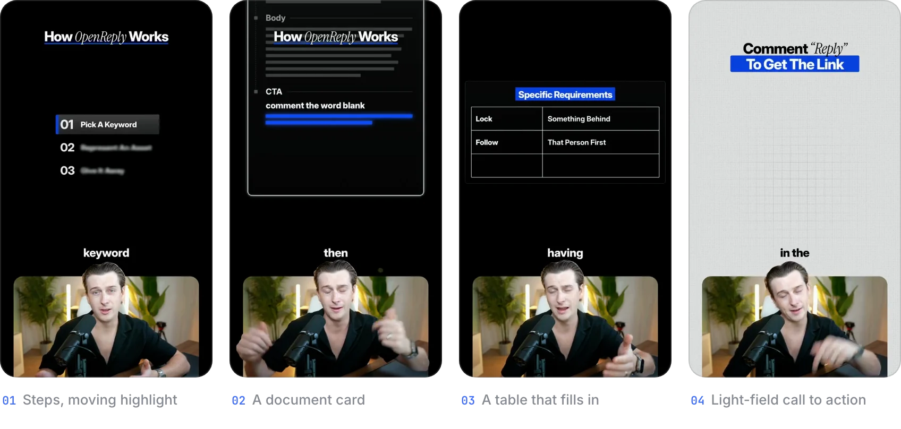
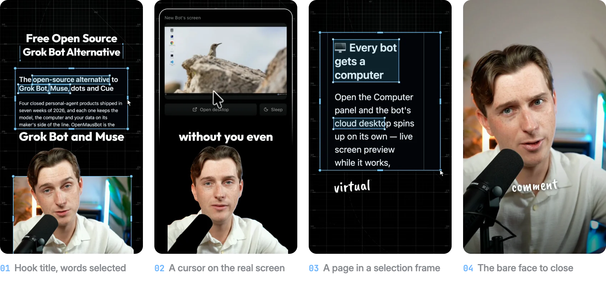
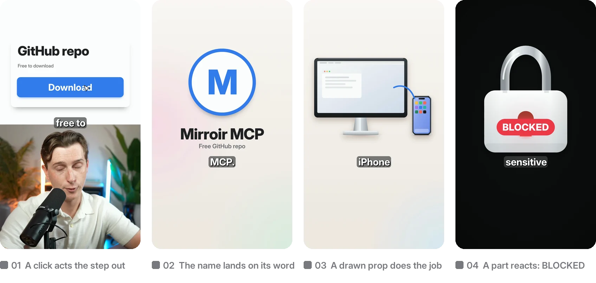
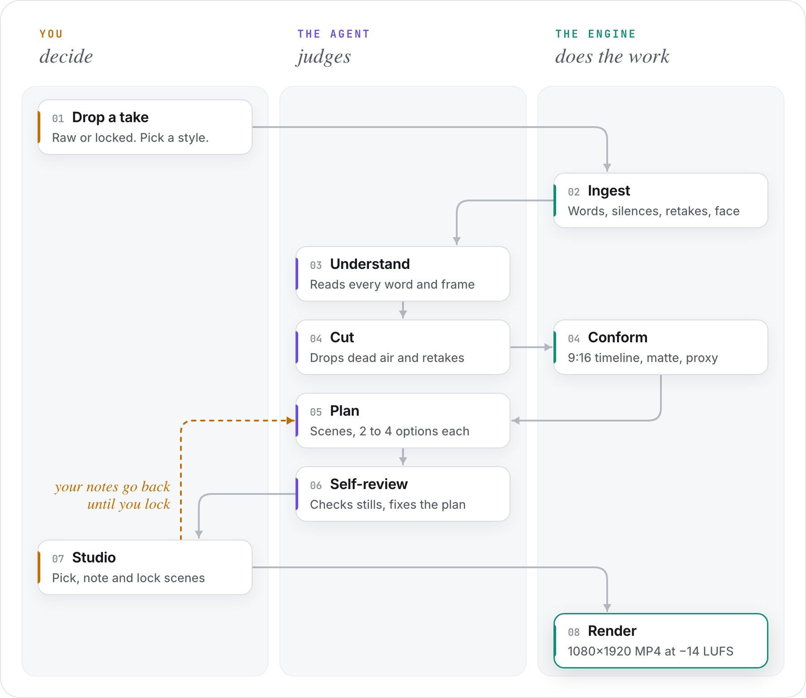
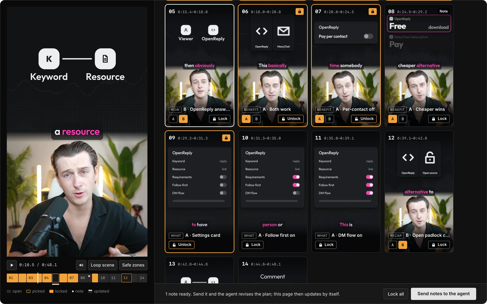

<p align="center">
  
</p>

<p align="center">
  <b>Motus edits talking-head video for Reels, TikTok and Shorts.</b><br>
  Your AI agent plans the edit. A local engine cuts, captions and renders it. You decide every scene.
</p>

<p align="center">
  <a href="CHANGELOG.md"></a>
  <a href="#seven-styles"></a>
  <a href="#install"></a>
  <a href="#codex-experimental"></a>
  <a href="#status-and-known-limits"></a>
  <a href="#requirements"></a>
  <a href="AGENTS.md"></a>
  <a href="LICENSE"></a>
</p>

<p align="center">
  <a href="#start-here"><b>Start here</b></a> ·
  <a href="#update">Update</a> ·
  <a href="#seven-styles">Styles</a> ·
  <a href="#how-it-works">How it works</a> ·
  <a href="#studio">Studio</a> ·
  <a href="#how-styles-are-made">How styles are made</a> ·
  <a href="#install">Install</a> ·
  <a href="#privacy">Privacy</a>
</p>

<br>

## Start here

1. Open Claude Code or Codex on your computer.
2. Paste this: **Clone https://github.com/kyleherbel/motus, then set up Motus and get started.** If you already have the folder, open it or drag it into the chat and say **go**.
3. The Motus app opens in your browser. Drop a video in it, pick a look, review the edit scene by scene, and render.

> [!TIP]
> Keep the chat open while you edit. The AI session does the planning in the background, and the app shows what it is doing. Your videos are kept in `~/Movies/Motus` on a Mac and `Videos\Motus` on Windows (set `MOTUS_HOME` to change that).

You give Motus a raw take or a picture-locked cut and pick a style. You choose between options for each scene on a local review page, and you get a 1080×1920 MP4.



The app asks how to cut the video and which look to use. Each style card plays a few seconds of a real edit in that style.

Version 0.5.0. Seven style packs, all in beta. Runs on macOS and Windows 10 or 11. Claude Code is the first target. OpenAI Codex support is experimental.

### Update

If you cloned the repository, paste this into Claude Code or Codex:

> Update Motus: stop the Motus app (`node engine/bin/motus.mjs app --stop`, in my Motus folder), run `git pull`, then start Motus again.

Stop the app before you pull. A running app server keeps serving the code it started with, and it stays up for up to 12 idle hours.

- **From a ZIP.** A folder from GitHub's Download ZIP is not linked to the repository, so `git pull` cannot update it. Ask your agent to replace it with a clone in the same place, under the same name, and to copy over anything of yours from the old folder.
- **As a Claude Code plugin.** Run `claude plugin marketplace update motus-market`, then `claude plugin update motus@motus-market`, and restart Claude Code.

Your videos live outside the Motus folder, so an update never touches them.

## Seven styles

A style is a pack of rules, layouts and elements studied from reference videos. Pick one per video. All seven are in beta: Ribbon Depth, Editorial Proof and Ember Brief are version 0.2.0; Night Class, Prop Room, Open Canvas and Seamline are 0.1.0. Ribbon Depth combines measured public examples with documented original extensions. Open Canvas is measured from a single clip.

The frames below come from real renders. The Ribbon Depth, Open Canvas, Editorial Proof and Ember Brief strips are all from one take, the same take the hero shows in six of the styles.

Ribbon Depth, Editorial Proof, Ember Brief and Prop Room draw cards that act the sentence out instead of repeating the caption: a count runs up to the number just said, a step lights up on its word, a pointer clicks the setting being named. When the speaker names a real product, the agent looks for the maker's own launch or demo video and cuts short clips of it into the edit, and `motus logo` fetches the brand's real mark for styles that show one.

### Ribbon Depth &nbsp;<sub><code>ribbon-depth</code></sub>

A bright speaker in their own darkened room, a turning 3D glass ribbon behind the head, frosted cards and icon tiles, and a cream capsule over a sans phrase with one heavy italic accent. Entrances go blur to sharp, the camera shakes on landings, and layout changes smear vertically. A scene library picks the device from what each sentence does, so it fits any topic or niche: counting numbers, stop-to-start swaps, charts, a hub with satellites, chat bubbles, notifications, quotes, a giant word behind the head, step stacks with a light trail, typed searches and a clicked button. The ribbon is a placed accent in four forms (spiral, sweep, halo, arc), not a background on every scene. A `split` layout puts the speaker in a glass window above a panel.



**Best for** polished talking-head reels on any topic or niche: personal brands and coaching; tool, product and money explainers; fitness, food and lifestyle tips. It is listed first in the app. Use `/motus:ribbon-reel`, or select Ribbon Depth in the app. Controls: Orange (default), Violet or Light Lime; motion intensity; ribbon strength; supporting captions. 17 elements and 6 layouts. See [the directing guide](skills/ribbon-reel/SKILL.md), [the style guide](styles/ribbon-depth/STYLE.md) and [what was measured](styles/ribbon-depth/research/README.md).

### Editorial Proof &nbsp;<sub><code>editorial-proof</code></sub>

**Claim, then proof.** The speaker sits in a panel at the bottom with real evidence above: captured pages, numbers, real brand marks. The designed cards act the sentence out: a question types in with the voice while the answer streams in, steps wait greyed and light up on their words, two sides converge or one wins, a divider wipes from before to after. Word-by-word captions with accent keywords, dark focus shots for close reading, and a comment call to action at the end. Two accent colours, emerald and violet, over a white grid.



**Best for** tool and product breakdowns, comparisons, news and explainer takes, anything with sources, numbers or screens to show. 20 elements and 4 layouts.

### Ember Brief &nbsp;<sub><code>ember-brief</code></sub>

**The 40-second tool briefing.** A dark dotted field fills the top half of the frame and the speaker fills the bottom half. A new graphic lands about every three seconds, each event on the word that names it. Most of the explaining pictures are composites that fill the field and keep moving while the speaker talks: app tiles feed one card along curving lines with dots flowing in, a task ticks off its steps while a Working bar fills, a pointer glides to a row and flips its switch, a chip pops out beside a captured row and counts up to the page's figure. The rest show evidence: real page captures with magenta highlights, app screens redrawn as dark cards, clips of the product's own demo video. For a tall graphic the speaker slides away and the field takes the frame.



**Best for** solo briefings of 30 to 45 seconds: new tool and feature explainers, news takes with a source to show, short numbered tool lists. 21 elements and 2 layouts.

### Night Class &nbsp;<sub><code>night-class</code></sub>

**The teaching explainer.** A black graphic field with a faint dot grid sits over a small rounded presenter panel. A centred title with a cobalt bar or underline sits at the top, and one-word captions sit between them. About every ten seconds the edit cuts hard to the full-height speaker, then cuts back to a changed graphic. It ends on a "Comment &lt;keyword&gt;" call to action.



**Best for** solo teaching videos: frameworks and playbooks, numbered steps and lists, how-tos and strategy explainers. 17 elements and 3 layouts.

### Open Canvas &nbsp;<sub><code>open-canvas</code></sub>

**The video as an open design file.** The speaker is cut out over their own footage rectangle on a black drafting grid that drifts upward. Real pages and screens sit in light-blue selection frames with handles, and a cursor drags them into place. Pointers land on the spoken word: a box means read, a dot means tap, a whip scroll means "or over here". Captions arrive one word at a time with one brush-script word a sentence. Every change is a hard cut. There is no music and no sound effect, and the video ends on the bare face with the comment keyword.



**Best for** tool and repo walkthroughs with real pages to show, and daily solo reels of 25 to 60 seconds. 5 elements and 6 layouts; five palettes (black and white by default). Measured from a single clip, so its rules are provisional. See [the style guide](styles/open-canvas/STYLE.md) and [what was measured](styles/open-canvas/research/README.md).

### Prop Room &nbsp;<sub><code>prop-room</code></sub>

**The pictures do the explaining.** A pale panel sits over the speaker, and about every two seconds the edit cuts hard: to a full-frame scene, back to the panel, now and then to the speaker full height. Every picture acts its sentence out on the words: a printer feeds out a page, a tank drains, a picker lands on its choice, a counter rolls to the number just spoken, a padlock turns red. The objects are drawn in code with moving parts, from a library of 22 props, and the editing agent draws new ones for a video when it needs them. One-to-three-word white captions sit on a dark plate across the seam, and the video ends on the speaker with a quoted keyword in a bold serif.



**Best for** solo tool, skill and workflow explainers of 30 to 47 seconds, where each step can become a picture. 20 elements and 3 layouts. See [the style guide](styles/prop-room/STYLE.md), [the prop library](styles/prop-room/props/README.md) and [what was measured](styles/prop-room/research/README.md).

### Seamline &nbsp;<sub><code>seamline</code></sub>

**Tech news over the real thing.** The top half of the frame plays real footage of what the speaker is talking about: the maker's launch film, its demo, the product doing the job, the output it made. The speaker sits at the desk in the bottom half. One or two caption words in white pixel capitals ride the hard seam between them. Everything is a hard cut: the footage changes about every 1.4 s on the word that names it, and short full-frame face inserts push in slowly on opinions and asides. A heavy extended headline slides in to open, a big word over the chest stresses the one word that carries a sentence, and a dark music bed sits under the voice.

**Best for** launch and release news with the maker's own footage, "X just shipped Y" takes and product demos of 45 to 90 seconds. 4 elements and 4 layouts. The edit is only as good as its footage: the agent pulls the maker's launch and demo videos for every product named, about five sources a video. See [the style guide](styles/seamline/STYLE.md) and [what was measured](styles/seamline/research/README.md).

### Side by side

| | Ribbon Depth | Editorial Proof | Ember Brief | Night Class | Open Canvas | Prop Room | Seamline |
|---|---|---|---|---|---|---|---|
| Frame | Full-frame speaker with graphics behind the head, a speaker window over a panel, and abstract glass scenes | Speaker panel at the bottom, evidence above, white grid | Dotted field over the speaker, half and half | Small presenter panel under a black dot-grid field | Speaker cut-out over their footage rectangle on a drafting grid, captures in selection frames | Pale panel over the speaker, cut every 2 s to full-frame scenes and short full-height speaker beats | Real footage over the speaker, split at the middle, with full-frame face and footage cuts |
| Captions | Words land one by one; capsule plus sans/heavy-italic hero | Word by word, accent keywords | Two words, the spoken word in magenta | One word | Word by word, one brush-script word a sentence | One to three words, white on a dark plate across the seam | Two words in white pixel capitals on the seam, shadow or plate |
| Signature move | A turning glass ribbon used as an accent, a scene library for any niche, shakes on landings | Designed cards that act the claim out, dark focus shots for close reading | A new graphic about every 3 s; composites that fill the field and keep moving | A hard cut to the full-height speaker about every 10 s | A cursor that drags windows into place and pointers that land on the spoken word | Code-drawn props and rebuilt app windows that act each sentence out on its words | The maker's own footage, cut on the word that names it, about 28 times a minute |
| Sound | Three optional original effects; no bundled bed | Sound effects and two music beds | No sound effects, one music bed | A sound kit and a music bed | Voice only | Original effects and three beds: two drum-led, one pad | Two dark beds (a 105 BPM pulse, a pad) and an optional opening swell |
| Look choices | Orange, Violet or Light Lime; motion intensity; ribbon strength; captions | Accent: emerald or violet | None | Sound kit, music bed, field texture | Palette: mono (default), cobalt, ember, moss, ink | None: the plate is chosen per scene | Caption shadow or plate, speaker grade, opening sound |
| Best source | Clear 9:16 take and a good matte; explicit no-matte fallback | Any take, cropped to 9:16 around the speaker | A shot wider than 9:16 (the horizontal recording) | A shot wider than 9:16 (the horizontal recording) | A 9:16 take with a good matte | A shot wider than 9:16 (the horizontal recording) | A shot wider than 9:16 (the horizontal recording), ideally 4K |
| Elements, layouts | 17, 6 | 20, 4 | 21, 2 | 17, 3 | 5, 6 | 20, 3 | 4, 4 |
| Measured from | Two Violet examples in one public promo; static bright-family boards | 33 short videos | 11 reels | 32 teaching reels | 1 reel | 19 reels | 30 reels |
| Version | 0.2.0 | 0.2.0 | 0.2.0 | 0.1.0 | 0.1.0 | 0.1.0 | 0.1.0 |

Each style's layouts, elements and their parameters are listed in `styles/<id>/style.json`. Run `/motus:styles` or `node engine/bin/motus.mjs styles` to see what is installed.

## How it works

The agent does the judgement. A local engine does the mechanical work. You decide in a browser page called Studio.

<picture>
  <source media="(prefers-color-scheme: dark)" srcset="docs/media/how-it-works-dark.png">
  
</picture>

The same style code draws the Studio preview and the final render, so what you approve is what you get.

<details>
<summary><b>The eight steps in detail</b></summary>
<br>

| # | Step | Who | What happens |
|---|---|---|---|
| 1 | Set up | you, agent | The agent runs `motus doctor`, asks for the video, whether it is raw or picture-locked, and which style. `motus init` creates a project folder. |
| 2 | Ingest | engine | Extracts the audio, transcribes it with word timings, finds silences and candidate retakes, tracks the face (macOS), and writes contact sheets with the time burnt into every cell. |
| 3 | Understand | agent | Reads the whole transcript and every contact sheet, writes `analysis/understanding.json`, and tells you in a few lines what the video is about. |
| 4 | Cut and conform | agent, engine | Raw mode: the agent chooses the source ranges to keep (dead air, false starts and retakes go). Locked mode: every frame stays. `motus conform` builds the output timeline, the person matte (macOS) and a preview proxy. |
| 5 | Plan | agent | Reads the style's `STYLE.md`, gathers evidence (captures of the web pages it wants to show, brand marks with `motus logo`, short clips of a named product's own demo video), and writes `plan/edit.json`: the video divided into scenes, each with 2 to 4 alternative treatments built from the style's layouts and elements. `motus validate` checks it. |
| 6 | Self-review | agent, engine | `motus stills` renders posters and contact sheets of the planned cut. The agent looks at them and fixes the plan before you see it. |
| 7 | Studio | you | A local page shows the plan scene by scene. You pick an option, leave notes, and lock scenes. "Send notes" hands your notes to the agent, which revises and updates the page. |
| 8 | Render | engine | Headless Chrome draws every frame of the final cut. ffmpeg encodes H.264 video and AAC audio, with loudness normalised to -14 LUFS. The result is `renders/final.mp4`. |

</details>

## Studio



Studio is a web page served from your own machine by `motus studio <project>`. The server listens on `localhost` only, on a free port, and stops by itself after six hours with no page open and no requests.

- **The player** on the left shows the current cut with a scene timeline under it.
- **The scene grid** shows each scene as a tile looping the option in the cut, about six to eight in view on a laptop. Hover a tile's A/B/C to see another option, click it to use that option, lock from the tile, or click the tile for the full scene. A switch shows the scenes as a list instead.
- **Per scene** you pick an option, write a note, and lock it. Each scene's section shows its time range, what is said, and the option cards playing over your real footage.
- **Whole video** holds the style's global choices (for Editorial Proof, the accent colour; for Night Class, the sound kit, the bed and the dark field) and an overall note.
- **Safe zones** shows where the Instagram Reels interface covers the frame. Its numbers come from one phone screenshot, so treat them as a guide.
- **"Send notes to the agent"** is the main button while any scene has a note. **"Render final video"** is enabled when every scene is locked. Rendering shows live progress and ends with the finished file.

Your decisions are saved in `review/state.json` inside the project, so nothing is lost if the page or the server closes.

<details>
<summary><b>Keyboard</b></summary>
<br>

| Key | Does |
|---|---|
| `J` / `K` | Next and previous scene |
| `1` to `4` | Pick an option |
| `L` | Lock |
| `N` | Note |
| `Space` | Play |
| `S` | Safe zones |
| `Cmd`/`Ctrl` + `Enter` | Send notes, or render |
| `?` | Show the list |

</details>

## How styles are made

Six packs are measured from reference videos: five from a corpus of 11 to 33 reels by one creator each, and Open Canvas from a single clip. Ribbon Depth studies a smaller set of public examples and clearly separates observed geometry and timing from reconstructed materials and original extensions.

<table>
  <tr>
    <td align="center" width="25%"><h3>126</h3>reference videos measured</td>
    <td align="center" width="25%"><h3>9</h3>dimensions per study</td>
    <td align="center" width="25%"><h3>229</h3>numbers re-measured in a second pass</td>
    <td align="center" width="25%"><h3>0</h3>reference frames shipped</td>
  </tr>
</table>

- **Editorial Proof** was built from 33 public short videos by one creator, published between 12 October and 9 November 2026. A second study of the reference's 255 designed graphics and 739 timed events (`styles/editorial-proof/research/explain.md`) showed that the cards act each sentence out, and the style now does the same.
- **Night Class** was built the same way from 32 teaching reels by another creator, published between 10 October and 11 November 2026. Its second pass re-measured 74 quantities and corrected 15 of them (`styles/night-class/research/verification.md`).
- **Ember Brief** was built from 11 reels by a third creator, published between 2 and 7 November 2026. Its second pass re-measured 107 quantities and corrected 11 (`styles/ember-brief/research/verification.md`). A second study measured how its illustrations and diagrams explain what is being said (`styles/ember-brief/research/explain.md`), and a third found that most of them are composites that fill the field and keep moving (`explain-composites.md`).
- **Prop Room** was built from 19 reels by one creator, published between 29 October and 12 November 2026, with an explanation pass over all 279 graphic units. Its verifier re-measured 29 quantities (`styles/prop-room/research/verification.md`).
- **Open Canvas** was measured from one public reel of 28.9 s, read at every frame. One clip cannot separate a habit of the style from a habit of one video, so every rule is medium or low confidence, and the pack stays in beta until a corpus of 15 or more clips is studied.
- **Seamline** was built from 30 reels by one creator, published between 11 March and 15 November 2026: the split-screen posts only, chosen from the creator's 40 newest (the other 10 use other formats). Analysts coded 1,207 cuts and 1,262 spoken clauses against the footage on screen, and the verifier re-measured 19 quantities on every frame of all 30 (`styles/seamline/research/verification.md`).
- **Ribbon Depth** studies one public 20-second promo that contains two Violet edits, and six public scene boards (`styles/ribbon-depth/research/README.md`).

For a corpus, nine analysts each measured one dimension: layout, type, hook, graphics, motion, structure, colour, audio, presenter. Every rule is a number with evidence: a count, a frame range, a fit error. A second pass re-measured the disputed and critical numbers. The numbers then became one tokens file, the elements were built against it, and each was compared side by side with reference frames.

The reference videos themselves are never part of this repository. Rights to them are unknown, so they stay on the machine of whoever does the study. Sound effects, music beds and background plates in a style pack are synthesised from the measurements, not copied. Each style also has its own release palette in place of the measured colours; every measured value sits next to its replacement in the style's `research/colour.md`.

The full method, a folder template and a definition-of-done checklist are in [docs/ADDING_A_STYLE.md](docs/ADDING_A_STYLE.md). The agent procedure is the `new-style` skill.

## Install

### Claude Code

In a Claude Code session:

```
/plugin marketplace add kyleherbel/motus
/plugin install motus@motus-market
```

Or from a shell:

```
claude plugin marketplace add kyleherbel/motus
claude plugin install motus@motus-market
```

From a local clone, without installing: `claude --plugin-dir /path/to/motus`.

| Command | What it does |
|---|---|
| `/motus:start` | Opens the Motus app and works its job queue in the background. The same as saying "go". |
| `/motus:edit` | Edits a video: the eight steps above, in the chat. |
| `/motus:styles` | Lists the installed styles and what each one suits. |
| `/motus:doctor` | Checks this machine and helps fix what is missing. |
| `/motus:ribbon-reel` | Edits a flexible ribbon/glass reel in Ribbon Depth. |
| `/motus:new-style` | Builds a new style pack from reference videos. For people who make styles. |

Motus needs local files, ffmpeg and a browser, so it runs in Claude Code on your own machine (the CLI, or a local session in the desktop app). It cannot run in claude.ai chat.

<details>
<summary><b>Plugin packaging and updates</b></summary>
<br>

The repository is both the marketplace and the plugin (`.claude-plugin/marketplace.json` points at `./`). The plugin version is set in `.claude-plugin/plugin.json`. Claude Code keeps the installed copy until that version string changes, and it does not auto-update third-party marketplaces unless you turn that on under `/plugin`, Marketplaces. To update by hand: `claude plugin marketplace update motus-market`, then `claude plugin update motus@motus-market`, then restart Claude Code.

</details>

### Codex (experimental)

The Codex packaging is in `.codex-plugin/plugin.json` and `.agents/plugins/marketplace.json`. It exposes the same `skills/` folder.

```
codex plugin marketplace add kyleherbel/motus
codex plugin add motus@motus-market
```

Then start a new Codex session and ask for the edit in words, or pick the skill from `/skills`.

<details>
<summary><b>What has and has not been checked with Codex</b></summary>
<br>

Checked: with codex-cli 0.167.1, `codex plugin marketplace add` on a local copy and `codex plugin list` find `motus@motus-market` at version 0.1.0.

Not checked: installing the plugin, loading the skills in a session, running an edit end to end, and whether the Codex sandbox lets the engine start headless Chrome and the local Studio server without an approval.

If the plugin route fails, clone the repository and start Codex inside the clone. `AGENTS.md` at the root tells Codex where the skills and the engine are. Ask it to follow `skills/edit/SKILL.md` for your video.

ChatGPT on the web or on a phone cannot run Motus: it has no access to local files, ffmpeg or a headless browser.

</details>

### Edit from the chat

The app is the main way in. If you would rather stay in the chat:

```
/motus:doctor
/motus:edit /path/to/take.mp4
```

1. The agent asks whether the video is raw or picture-locked and which style to use.
2. It ingests the video and tells you what it understood. Correct it if it is wrong.
3. It plans the edit, reviews its own stills, and opens Studio in your browser.
4. In Studio, watch the options, pick one per scene, write notes where something should change, and lock the scenes you are happy with.
5. Press "Send notes to the agent" to get revisions. Press "Render final video" once every scene is locked.
6. The file is at `motus-projects/<video name>/renders/final.mp4` in the folder where you started the agent.

If you would rather skip Studio, say "just render it" and the agent renders its own picks.

<details>
<summary><b>The engine by hand</b></summary>
<br>

The engine is a plain command line tool. The agent normally runs it, but you can too:

```
node engine/bin/motus.mjs help
node engine/bin/motus.mjs doctor
node engine/bin/motus.mjs init take.mp4 --style editorial-proof --mode raw
node engine/bin/motus.mjs ingest motus-projects/take
node engine/bin/motus.mjs conform motus-projects/take      # needs plan/cuts.json in raw mode
node engine/bin/motus.mjs capture https://example.com --out motus-projects/take/assets/page.png --find "a phrase"
node engine/bin/motus.mjs logo Notion --out motus-projects/take/assets/logos/notion.png
node engine/bin/motus.mjs validate motus-projects/take     # needs plan/edit.json
node engine/bin/motus.mjs stills motus-projects/take --posters --sheet
node engine/bin/motus.mjs studio motus-projects/take --open
node engine/bin/motus.mjs render motus-projects/take
```

`plan/cuts.json` and `plan/edit.json` are written by the agent (or by you). Add `--json` to any command for machine-readable output. Errors come with a `fix:` line.

</details>

## Requirements

| Need | Notes |
|---|---|
| macOS or Windows 10/11 | Both tested. Linux has the code paths but has not been run. See [Status and known limits](#status-and-known-limits). |
| Node.js 22 or newer | Runs the engine. No npm packages are installed. Windows: `winget install OpenJS.NodeJS.LTS`. |
| ffmpeg and ffprobe | A build with libx264 and the filters drawtext, loudnorm, silencedetect, tile and hstack. macOS: `brew install ffmpeg`. Windows: `winget install Gyan.FFmpeg`, then open a new terminal so it is on PATH. |
| Google Chrome | Or Chromium, Microsoft Edge or Brave. Used headless for rendering and page capture. On Windows the Edge that ships with the system is enough. |
| Python 3.9 or newer with `faster-whisper` | Transcription. macOS: `python3 -m pip install faster-whisper`. Windows: `winget install Python.Python.3.12`, then `py -3 -m pip install faster-whisper`. The first transcription downloads the speech model (`large-v3-turbo`, about 1.6 GB). |
| Xcode command line tools | Optional, macOS only. Provides `swiftc` for the person matte and face tracking (Apple Vision). `xcode-select --install`. The helper is compiled on first use into `~/.cache/motus`. |
| Claude Code, or Codex CLI | The agent that drives the engine. |
| `yt-dlp` | Optional. The agent uses it to download a named product's own launch or demo video for clips. macOS: `brew install yt-dlp`. Windows: `winget install yt-dlp.yt-dlp`. |

`motus doctor` checks every required line of this table and prints a fix for anything missing. It does not check `yt-dlp`.

Environment overrides: `MOTUS_CHROME` (browser binary), `MOTUS_PYTHON` (interpreter), `MOTUS_WHISPER_MODEL` (for example `small` on a slow machine), `MOTUS_CACHE` (where the compiled helper is kept), `MOTUS_STYLES` (another styles folder), `MOTUS_HOME` (the app's workspace).

<details>
<summary><b>Repository layout</b></summary>
<br>

```
.claude-plugin/        plugin.json and marketplace.json for Claude Code
.codex-plugin/         plugin.json for Codex (experimental)
.agents/plugins/       marketplace.json for Codex (experimental)
skills/                start, edit, ribbon-reel, styles, doctor, new-style: the agent procedures
engine/bin/motus.mjs   the command line tool
engine/lib/            Node side: project, ingest, conform, plan, capture, render, app and Studio server
engine/py/             transcription (faster-whisper)
engine/swift/          Apple Vision matte and face tracking, compiled on first use
engine/runtime/        the browser stage shared by preview and render, and the kit styles draw with
engine/app/            the Motus app page
engine/studio/         the Studio page
styles/<id>/           one folder per style pack
docs/                  ARCHITECTURE.md, ADDING_A_STYLE.md, media/ (images for this page)
tests/                 node:test suites and fixtures (node --test tests/; MOTUS_E2E=1 adds a full render)
AGENTS.md              entry point for Codex and other agents
CHANGELOG.md
```

Two more folders exist on a developer's machine and are ignored by git: `corpus/` (reference videos and the studies made from them) and `projects/` (local test projects).

How the parts fit together is in [docs/ARCHITECTURE.md](docs/ARCHITECTURE.md).

</details>

## Privacy

The engine runs on your machine. It has no telemetry and no upload code. Its own network use is limited to three things:

1. **Page capture.** `motus capture <url>` opens the page the agent chose in headless Chrome and screenshots it.
2. **The speech model.** The first transcription downloads the model through `faster-whisper`, once.
3. **Brand marks.** `motus logo <brand>` loads the Simple Icons brand list from jsDelivr, asks Google's favicon service for the brand's site icon, and falls back to the brand's Simple Icons mark when the site icon is missing or too small. What goes out is the brand's name and site domain.

Chrome is started with a temporary empty profile. Motus does not control any background requests the browser itself makes.

The agent is a separate matter. Claude Code and Codex are cloud models. What the agent reads to do its job (the transcript, contact sheets, stills, captured pages) is sent to the agent's provider under your agreement with them. The video file itself is not uploaded by Motus. When the speaker names a real product, the agent may also download that product's own demo video from its site, repository or the maker's posts, to cut clips from it.

Your source video is treated as read-only. Everything Motus writes goes into the project folder, plus a compiled helper in `~/.cache/motus`.

## Status and known limits

- **Windows works without the person matte.** The person matte and face tracking use Apple Vision through a small Swift helper, so they are macOS only. On Windows (and on a Mac without the Swift toolchain) the engine falls back to un-matted framing: no head rising above the presenter panel, and a centre crop for sources that are not 9:16. Everything else (the app, transcription, Studio, rendering) runs the same. Windows is checked on a Windows runner: `motus doctor`, transcription with faster-whisper, the app and Studio servers, the unit tests and an end-to-end render. Linux has code paths but has not been run.
- **Transcription on an NVIDIA GPU** needs the CUDA libraries (cuBLAS, cuDNN). Without them it falls back to the CPU on its own, which is slower.
- **Seven style packs, all in beta.** Expect their elements and rules to change before 1.0. Open Canvas is measured from a single clip, so its rules are provisional.
- **Output** is always 1080×1920 at the source frame rate. Draft renders are 540×960. A style can also ask conform to keep the whole source frame as a wide view (Night Class, Ember Brief and Prop Room do); then the preview proxy is about 3870 px wide.
- **The source must contain the speech.** A file with no audio stream cannot be planned.
- **Transcription is automatic** and makes mistakes, mostly on names. The agent repairs captions from context. Pass names up front to help it.
- **English only, so far.** The styles were measured on English-language videos. Other languages transcribe, but the caption rules have not been tested on them.
- **Check the facts.** Text and numbers on screen come from what the speaker says or from a captured page. The agent is told never to invent evidence, but you should still check facts in Studio.
- **Codex support is experimental** (see [above](#codex-experimental)).

## Licence

Code: MIT, see [LICENSE](LICENSE).

Bundled fonts (Inter, EB Garamond, JetBrains Mono, Instrument Serif, Outfit, DM Sans, Playfair Display, PT Serif, Caveat Brush) are under the SIL Open Font License 1.1: see `OFL.txt` beside them. The styles' sound effects and music beds are original, synthesised by each style's `dev/make-audio.mjs`, and MIT like the code: see `LICENSE.md` beside them.

Reference corpora are never included. A style pack contains measurements and original assets only.

<br>

<p align="center">
  <sub>
    <a href="CHANGELOG.md">Changelog</a> ·
    <a href="docs/ARCHITECTURE.md">Architecture</a> ·
    <a href="docs/ADDING_A_STYLE.md">Adding a style</a> ·
    <a href="AGENTS.md">Notes for agents</a>
  </sub>
</p>
